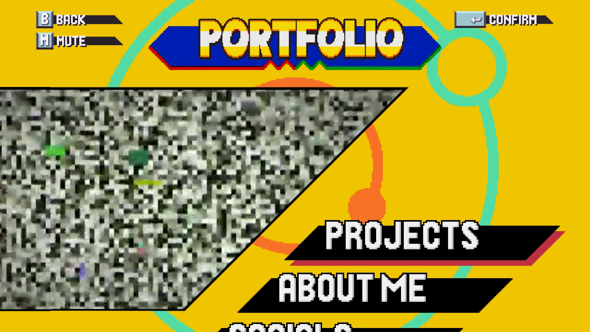
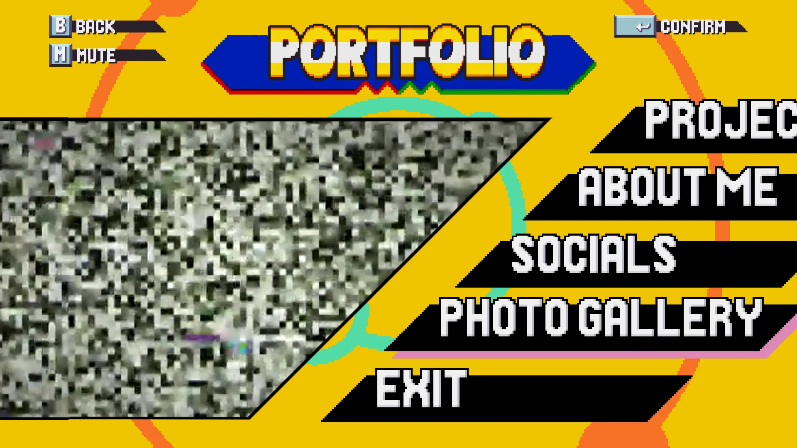

# Portfolio

An interactive portfolio website styled like a retro console game menu. You navigate it
the way you would a game: arrow keys, Enter and B, or just mouse and touch. It's built
with Vite and plain TypeScript (no framework), with performance on phones as a priority.



| Moving the selection | On a phone |
| --- | --- |
|  |  |

> **Status:** the title screen and main menu are finished. The Projects, About Me,
> Socials and Photo Gallery pages are still being built.

## Features

- **Game-style main menu**: slanted pixel-art buttons that bounce when you select them.
  The label hops a touch ahead of its button and flashes when you confirm.
- **Key prompts in the corners**: [B] BACK, [M] MUTE and [↵] CONFIRM on every page. They
  work with the keyboard or a click/tap.
- **Background music**: a random track plays on each screen, with a "Now Playing"
  pop-up. Tracks are normalised to the same perceived loudness. Mute only affects
  the music and is remembered between visits.
- **Transitions**: a three-panel slanted wipe between pages, and a fade between the
  title screen and the menu.
- **Animated backdrop**: two spinning, pulsing rings drawn with a WebGL shader (with an
  SVG fallback), and pixel TV static rolling inside the TV frame (the same static as the
  Projects page's TV).
- **Landscape first**: phones are asked to rotate, and desktop browsers to go full screen
  or maximise the window.

## Controls

| Action         | Keyboard   | Mouse / touch                               |
| -------------- | ---------- | ------------------------------------------- |
| Move selection | ↑ / ↓      | Click a button                              |
| Confirm        | Enter or Z | Click the selected button, or **CONFIRM**   |
| Back           | B or Esc   | **BACK**                                    |
| Mute music     | M          | **MUTE**                                    |

## Performance

The site was tuned for mid-range phones:

- The rings are drawn by a fragment shader in a single draw call per frame, instead of
  re-laying-out and repainting two full-screen SVGs. That roughly halves the main-thread
  work while the menu is open.
- Images are converted to WebP at build time (lossless for the pixel art). The sound
  effects are re-encoded, and audio-file metadata and cover art are stripped from the
  build.
- The TV static is drawn in code once, into a four-frame strip that a CSS transform rolls
  through, rather than played from a video: no download, and no work for the main thread.
- Assets load in order of need: the title image first, then sound effects, then the menu
  graphics. Nothing large competes with the first screen.
- Sound effects play through the Web Audio API for instant playback (including on iOS).
- Each page shows its background colour and transition panels on the very first paint,
  so nothing flashes while the scripts load.

## Running it locally

You need [Node.js](https://nodejs.org/) 20.19+ or 22.12+.

```bash
npm install
npm run dev       # dev server, also reachable from a phone on the same Wi-Fi
npm run build     # type-check + production build into dist/
npm run preview   # serve the production build
```

Background tracks in `src/assets/bg_music/` are automatically normalised to
-18 LUFS with a -2 dB true-peak ceiling using FFmpeg's two-pass
[`loudnorm`](https://ffmpeg.org/ffmpeg-filters.html#loudnorm) filter, in both dev
and production. Original audio files stay untouched. FFmpeg is installed by the
`ffmpeg-static` build dependency; no system installation is needed on supported
platforms. The first build processes every track; later runs reuse `.cache/music/`
unless the source audio or normalisation settings change. New tracks are picked
up automatically, and sound effects are unaffected.

## Project structure

```
index.html, projects.html, …   one HTML file per page
src/
  pages/        entry script for each page
  scenes/       title screen and main menu
  components/   menu buttons, corner HUD, rings, TV, "Now Playing" pop-up
  core/         page setup, page transitions, screen guard, input lock
  utils/        sound effects, background music, pixel-perfect hit testing
  assets/       art, sounds and music, grouped by page
```

## Built with

- [Vite](https://vite.dev/) and TypeScript
- [vite-imagetools](https://github.com/JonasKruckenberg/imagetools) / sharp for the image pipeline
- WebGL, the Web Audio API and the Web Animations API

## Credits

- Pixel art and UI graphics: made by me. The visual style is inspired by the menus of
  *Sonic Mania*.
- Music: tracks from the *Sonic Mania* soundtrack (© SEGA; music by Tee Lopes and the
  game's other composers). They're used in this non-commercial personal project, and all
  rights belong to their owners.
- Pictures on the Projects page's TV, from Wikimedia Commons (in `src/assets/projects/shots/`).
  Each is cropped or fitted to the TV screen's shape (on its own background colour) and resized;
  the adaptations of CC BY-SA works are shared under the same licence:
  - `tsp_solved_tours.png`: [Travelling salesman problem solved with simulated annealing](https://commons.wikimedia.org/wiki/File:Travelling_salesman_problem_solved_with_simulated_annealing.gif),
    by Geodac, [CC0](https://creativecommons.org/publicdomain/zero/1.0/) (its last frame), beside
    [GLPK solution of a travelling salesman problem](https://commons.wikimedia.org/wiki/File:GLPK_solution_of_a_travelling_salesman_problem.png),
    by Xypron, public domain
  - `tsp_ga_diagram.png`: [Genetic algorithm](https://commons.wikimedia.org/wiki/File:Genetic_algorithm.png),
    by Kacperkossa12, [CC BY-SA 4.0](https://creativecommons.org/licenses/by-sa/4.0/)
  - `tsp_pso_swarm.png`: [PSO swarm behaviour optimized for presentation](https://commons.wikimedia.org/wiki/File:PSO_swarm_behaviour_optimized_for_presentation.gif),
    by Hennegrolsch, [CC BY-SA 4.0](https://creativecommons.org/licenses/by-sa/4.0/) (its first frame)
  - `tsp_branch_bound.png`: [Branchbound](https://commons.wikimedia.org/wiki/File:Branchbound.gif), by Saurabh.harsh,
    [CC BY-SA 3.0](https://creativecommons.org/licenses/by-sa/3.0/) (its last frame)
  - `bitcoin_block_chain.png`: [Bitcoin Block Data](https://commons.wikimedia.org/wiki/File:Bitcoin_Block_Data.svg),
    by Matthäus Wander, [CC BY-SA 3.0](https://creativecommons.org/licenses/by-sa/3.0/)
  - `bitcoin_voronoi.png`: [Voronoi Diagram, Capitals of Every Country](https://commons.wikimedia.org/wiki/File:Voronoi_Diagram,_Capitals_of_Every_Country.jpg),
    by Vardan Semerjyan, [CC BY-SA 3.0](https://creativecommons.org/licenses/by-sa/3.0/)
  - `bitcoin_hash_tree.png`: [Hash tree 02](https://commons.wikimedia.org/wiki/File:Hash_tree_02.png), public domain
  - `bitcoin_payment_channel.png`: [Update of a micropayment channel](https://commons.wikimedia.org/wiki/File:Update_of_a_micropayment_channel.jpg),
    by Conrad Burchert, Christian Decker and Roger Wattenhofer ([Royal Society Open Science, 2018](https://royalsocietypublishing.org/doi/10.1098/rsos.180089)),
    [CC BY 4.0](https://creativecommons.org/licenses/by/4.0/)
  - `physics_suvat.png`: [Suvat eom any direction constant acceleration](https://commons.wikimedia.org/wiki/File:Suvat_eom_any_direction_constant_acceleration.svg),
    by Maschen, [CC0](https://creativecommons.org/publicdomain/zero/1.0/)
