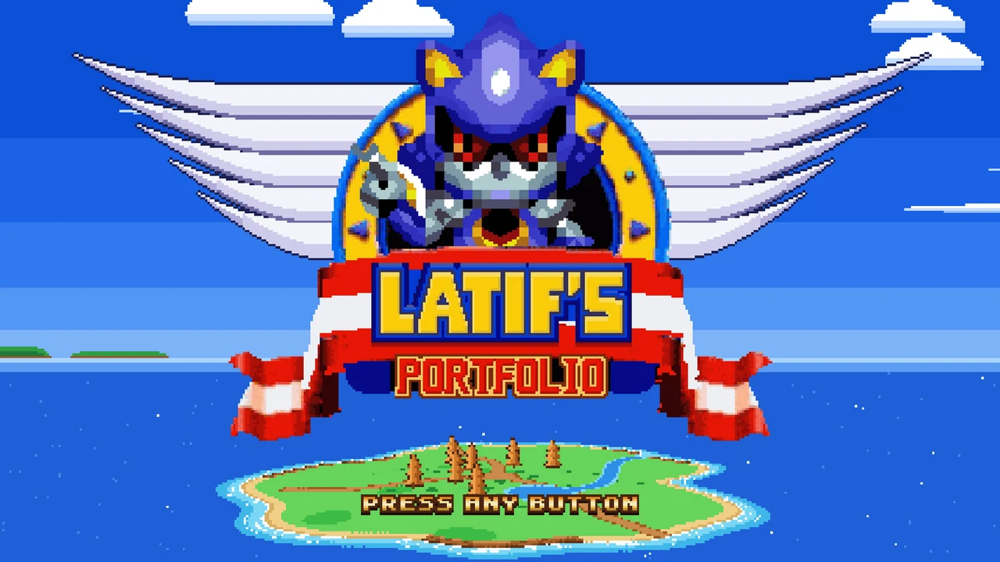
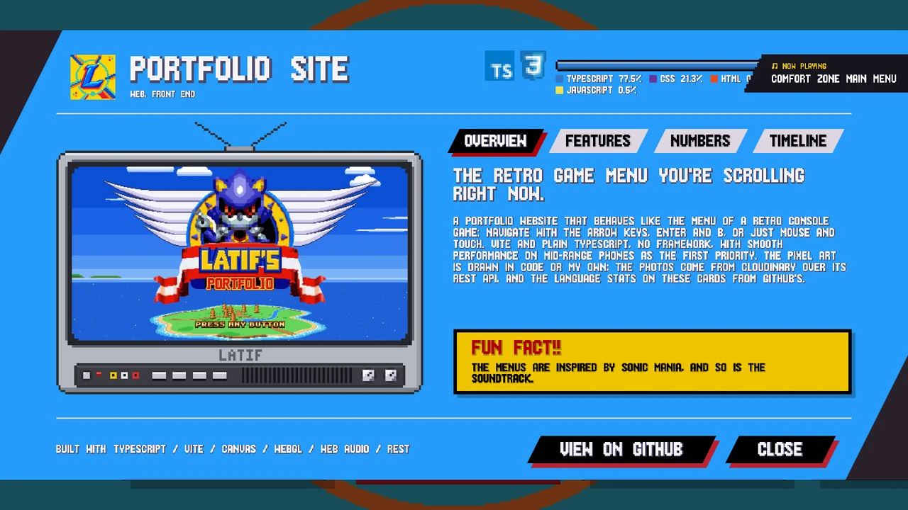
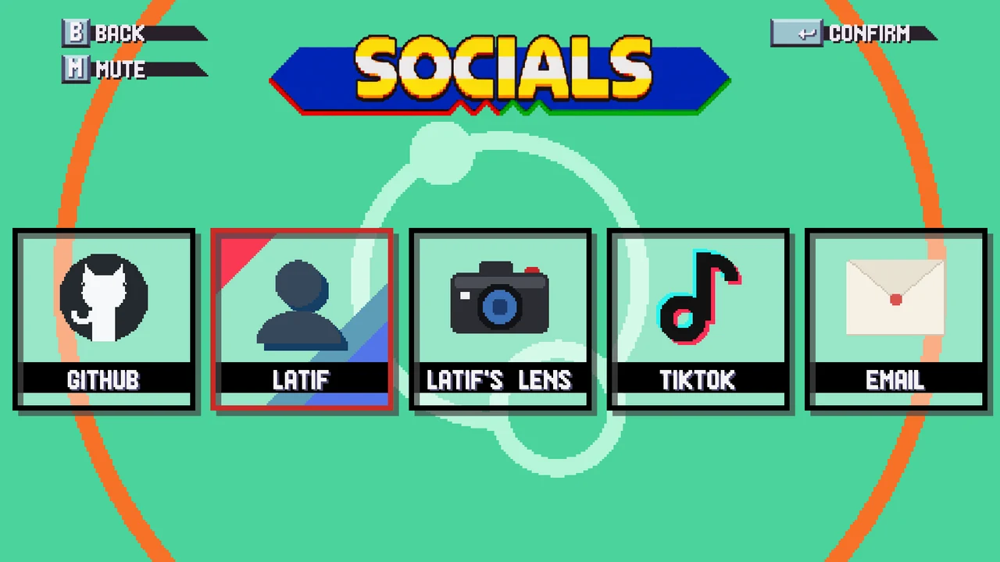
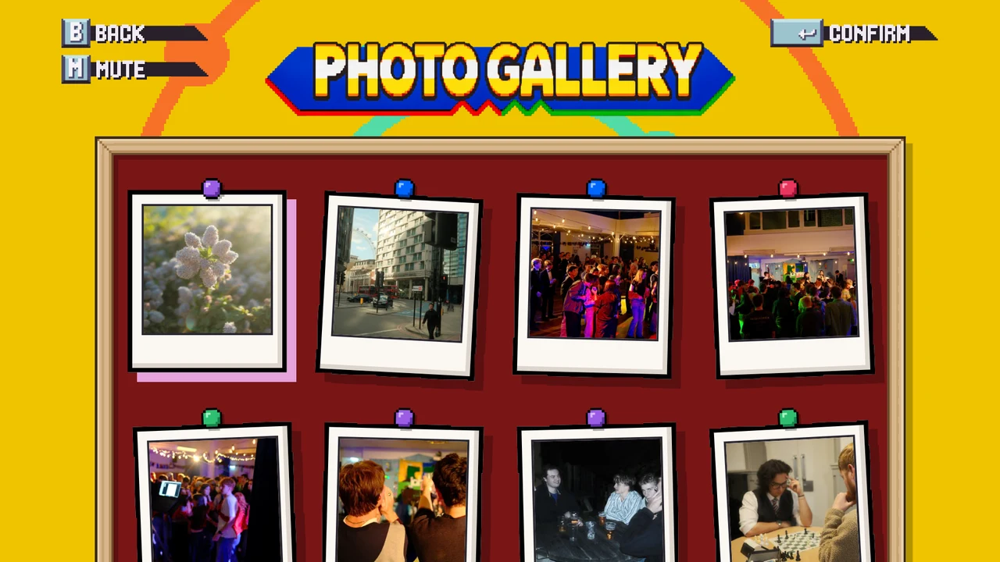
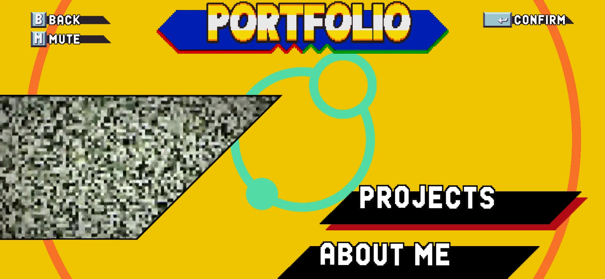

# Latif's Portfolio

A portfolio website that behaves like the menu of a retro console game. You navigate it the
way you would a game: arrow keys, Enter and B, or just mouse and touch. It's built with Vite
and plain TypeScript (no framework), with smooth performance on mid-range phones as the
first priority, and almost everything on screen is pixel art drawn in code.




| Projects | Socials |
| --- | --- |
|  |  |

| Photo Gallery | On a phone |
| --- | --- |
|  |  |

> **Status:** the title screen, main menu, Projects, Socials and Photo Gallery pages are
> done. About Me is next.

## What's on it

- **Title screen**: a medal (my GitHub profile picture in a studded gold ring, over a
  ribbon lettered in a chunky game font) over an island spinning in the sea, drawn Mode 7
  style by a WebGL fragment shader, with a sky strip scrolling slower behind it. "Press any
  button" flashes over the island.
- **Main menu**: slanted pixel-art buttons that bounce when you select them; the label hops
  a touch ahead of its button and flashes when you confirm. A CRT TV previews whichever
  page is highlighted, each with its own little show: my profile picture hopping along
  GitHub contribution squares, my social logos drifting and bouncing off each other like a
  DVD screensaver, a camera charging up and flashing under a starry sky, and, for Exit, a
  bedroom whose lights go down.
- **Projects**: a save-select carousel of cards, each with the project's logo and its
  languages. Open one and a game-style dialog slides in: a TV showing pictures of the
  project (its real output, figures from its report, or its screens), tabs for an overview,
  features, numbers and a timeline, and a button to its GitHub repo.
- **Socials**: a character-select screen of my accounts, with the clip's red-to-pink pulse
  on the selected box.
- **Photo Gallery**: my photos as polaroids pinned to a big felt board that grows with
  them, each hanging at its own slight tilt and straightening with a little wobble when
  selected. Select one to see it big. The photos come from Cloudinary over its REST API.
- **Key prompts in the corners**: [B] BACK, [M] MUTE and [↵] CONFIRM on every page. They
  work with the keyboard or a click/tap.
- **Background music**: a random track plays on each screen, with a "Now Playing" pop-up.
  Tracks are normalised to the same perceived loudness. Mute only affects the music and is
  remembered between visits.
- **Transitions**: a three-panel slanted wipe between pages, and a fade between the title
  screen and the menu, both timed from a reference clip.
- **Animated backdrop**: two spinning, pulsing rings drawn with a WebGL shader (with an SVG
  fallback), and pixel TV static rolling on the TVs between shows.
- **Landscape first**: phones are asked to rotate, and desktop browsers to go full screen
  or maximise the window.

## Controls

| Action         | Keyboard            | Mouse / touch                                  |
| -------------- | ------------------- | ---------------------------------------------- |
| Move selection | Arrow keys          | Hover or tap; swipe or scroll a carousel/wall  |
| Confirm / open | Enter or Z          | Click the selected thing again, or **CONFIRM** |
| Switch tabs    | ← / → (in a pop-up) | Click a tab                                    |
| Back / close   | B or Esc            | **BACK**, or click outside a pop-up            |
| Mute music     | M                   | **MUTE**                                       |

## Performance

The site was tuned for mid-range phones, checked headless in Chrome with Playwright at phone
and desktop sizes (screenshots against the references, round trips between screens, and
main-thread cost on a 4x-throttled phone):

- The rings and the title screen's island are drawn by fragment shaders, one draw call per
  frame, instead of re-laying-out and repainting big DOM elements; both fall back to a
  still frame without WebGL or with reduced motion.
- Pixel art is drawn on canvases at exactly one pixel per art pixel and redrawn only when
  something moves. The TV static is drawn in code once, into a four-frame strip that a CSS
  transform rolls through: no download, and no work for the main thread.
- Images are converted to WebP at build time (lossless for the pixel art), and the project
  pictures are cropped and sized for the TV. The sound effects are re-encoded, and
  audio-file metadata and cover art are stripped from the build.
- Assets load in order of need: the title screen first, then sound effects, then the menu
  graphics. Nothing large competes with the first screen, and a service worker caches the
  content-hashed assets.
- Gallery photos are requested at a few fixed sizes through Cloudinary's URL transforms, so
  its cache and free plan go further.
- Sound effects play through the Web Audio API for instant playback (including on iOS).
- Each page shows its background colour and transition panels on the very first paint, so
  nothing flashes while the scripts load.

## Running it locally

You need [Node.js](https://nodejs.org/) 20.19+ or 22.12+.

```bash
npm install
npm run dev       # dev server, also reachable from a phone on the same Wi-Fi
npm run build     # type-check + production build into dist/
npm run preview   # serve the production build
```

Background tracks in `src/assets/bg_music/` are automatically normalised to
-18 LUFS with a -2 dB true-peak ceiling using FFmpeg's two-pass
[`loudnorm`](https://ffmpeg.org/ffmpeg-filters.html#loudnorm) filter, in both dev
and production. Original audio files stay untouched. FFmpeg is installed by the
`ffmpeg-static` build dependency; no system installation is needed on supported
platforms. The first build processes every track; later runs reuse `.cache/music/`
unless the source audio or normalisation settings change. New tracks are picked
up automatically, and sound effects are unaffected.

The Photo Gallery lists the images tagged `gallery` in a Cloudinary account (the cloud name
is in `src/config.ts`); with none tagged, or no account, it says so.

## Project structure

```
index.html, projects.html, …   one HTML file per page
src/
  pages/        entry script for each page
  scenes/       title screen and main menu
  components/   the medal and island, menu buttons, corner HUD, rings, TV and its shows,
                project cards and pop-up, socials boxes, polaroids and pin board, pop-ups
  core/         page setup, page transitions, screen guard, input lock
  utils/        sound effects, background music, pixel art, pixel fonts, Cloudinary
  projects.ts, socials.ts   the data behind the Projects and Socials pages
  assets/       art, sounds and music, grouped by page
```

## Built with

- [Vite](https://vite.dev/) and TypeScript
- [vite-imagetools](https://github.com/JonasKruckenberg/imagetools) / sharp for the image pipeline
- WebGL, the Canvas and Web Audio APIs, and the Web Animations API
- [Cloudinary](https://cloudinary.com/) for the gallery's photos
- [Playwright](https://playwright.dev/) for headless checks

## Credits

- Pixel art and UI graphics: made by me (most of it drawn in code), after the look of
  *Sonic Mania*'s menus. The title screen's medal is adapted from *Sonic Mania*'s title
  (© SEGA), with my own wings, name and profile picture on it; the menu, prompts and page
  wipe were timed from clips of the game.
- Music: tracks from the *Sonic Mania* soundtrack (© SEGA; music by Tee Lopes and the
  game's other composers). They're used in this non-commercial personal project, and all
  rights belong to their owners.
- Language logos on the project cards: made from [Devicon](https://devicon.dev/) (MIT).
- Pictures on the Projects page's TV, from Wikimedia Commons (in `src/assets/projects/shots/`).
  Each is cropped or fitted to the TV screen's shape (on its own background colour) and resized;
  the adaptations of CC BY-SA works are shared under the same licence:
  - `tsp_solved_tours.png`: [Travelling salesman problem solved with simulated annealing](https://commons.wikimedia.org/wiki/File:Travelling_salesman_problem_solved_with_simulated_annealing.gif),
    by Geodac, [CC0](https://creativecommons.org/publicdomain/zero/1.0/) (its last frame), beside
    [GLPK solution of a travelling salesman problem](https://commons.wikimedia.org/wiki/File:GLPK_solution_of_a_travelling_salesman_problem.png),
    by Xypron, public domain
  - `tsp_ga_diagram.png`: [Genetic algorithm](https://commons.wikimedia.org/wiki/File:Genetic_algorithm.png),
    by Kacperkossa12, [CC BY-SA 4.0](https://creativecommons.org/licenses/by-sa/4.0/)
  - `tsp_pso_swarm.png`: [PSO swarm behaviour optimized for presentation](https://commons.wikimedia.org/wiki/File:PSO_swarm_behaviour_optimized_for_presentation.gif),
    by Hennegrolsch, [CC BY-SA 4.0](https://creativecommons.org/licenses/by-sa/4.0/) (its first frame)
  - `tsp_branch_bound.png`: [Branchbound](https://commons.wikimedia.org/wiki/File:Branchbound.gif), by Saurabh.harsh,
    [CC BY-SA 3.0](https://creativecommons.org/licenses/by-sa/3.0/) (its last frame)
  - `bitcoin_block_chain.png`: [Bitcoin Block Data](https://commons.wikimedia.org/wiki/File:Bitcoin_Block_Data.svg),
    by Matthäus Wander, [CC BY-SA 3.0](https://creativecommons.org/licenses/by-sa/3.0/)
  - `bitcoin_voronoi.png`: [Voronoi Diagram, Capitals of Every Country](https://commons.wikimedia.org/wiki/File:Voronoi_Diagram,_Capitals_of_Every_Country.jpg),
    by Vardan Semerjyan, [CC BY-SA 3.0](https://creativecommons.org/licenses/by-sa/3.0/)
  - `bitcoin_hash_tree.png`: [Hash tree 02](https://commons.wikimedia.org/wiki/File:Hash_tree_02.png), public domain
  - `bitcoin_payment_channel.png`: [Update of a micropayment channel](https://commons.wikimedia.org/wiki/File:Update_of_a_micropayment_channel.jpg),
    by Conrad Burchert, Christian Decker and Roger Wattenhofer ([Royal Society Open Science, 2018](https://royalsocietypublishing.org/doi/10.1098/rsos.180089)),
    [CC BY 4.0](https://creativecommons.org/licenses/by/4.0/)
  - `physics_suvat.png`: [Suvat eom any direction constant acceleration](https://commons.wikimedia.org/wiki/File:Suvat_eom_any_direction_constant_acceleration.svg),
    by Maschen, [CC0](https://creativecommons.org/publicdomain/zero/1.0/)
